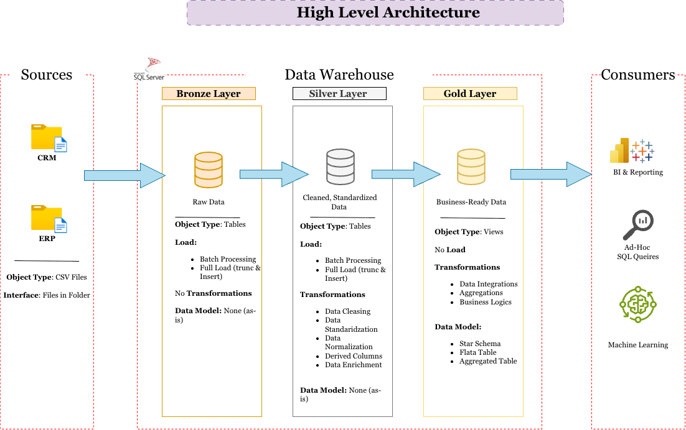

# Data Warehouse and Analytics Project

Welcome to the **Data Warehouse and Analytics Project** repository! 
This project demonstrates a comprehensive data warehousing and analytics solutions, from building a data warehouse to generating actionable insights. Designed as a portfolio project highlights industry best practices in data engineering and analytics. 

## SetUp Guide
```
sql-data-warehouse-project/
├── 00_setup/               the setup guide, and the one-click Docker start for Mac
├── 01_datasets/            the six source files the project loads
│   ├── source_crm/         three files from the CRM system
│   └── source_erp/         three files from the ERP system
├── 02_docs/                the requirements, the diagrams and the notes
├── 03_scripts/             the project scripts, in the order of the videos
│   ├── init_database.sql   creates the database: run it first
│   ├── bronze/             loads the raw files
│   ├── silver/             cleans and prepares the data
│   └── gold/               builds the tables for analysis
└── 04_tests/               checks the quality of the silver and gold data
```
## 🏗️ Data Architecture

This Project has Three Data Layers which includes **Bronze Layer**, **Silver Layer**, **Gold Layer**


1. **Bronze Layer**: This Layer stores raw data as-is from the source systems. Data is ingested from CSV Files into SQL Server Database.
2. **Silver Layer**: This layer includes data cleansing, standardization, and normalization processes to prepare data for analysis.
3. **Gold Layer**: Houses business-ready data modeled into a star schema required for reporting and analytics.
## My SQL Journey

Hello, I am Pujitha Jujjarapu!

I recently completed over 30 hours of SQL training through the Data with Baraa YouTube channel. Throughout this course, I learned a lot, from the fundamentals of SQL to advanced concepts.

Alongside the course, I regularly practiced SQL problems on LeetCode and maintained this GitHub repository to document my practice queries and learning progress.

I have always enjoyed writing SQL queries and working with databases and tables. However, before taking this course, I hadn't explored many advanced SQL concepts, such as CTEs, views, and indexes, in depth. This course helped me understand these concepts and gave me more confidence in writing complex queries.

One of the things I appreciated most about this course was learning from Baraa's industry experience of over 15 years. He didn't just explain how to write queries; he also explained why he chose a particular approach and how to write queries more efficiently. This helped me understand the importance of not only getting the correct result but also writing SQL that is efficient, maintainable, and backed by sound reasoning.

I am grateful for the knowledge I've gained through this course and look forward to continuing my SQL journey, learning more, and improving my skills.

**There's still a lot to learn, and this is just the beginning!**
## Acknowledgment

This project was built by following the tutorials and instructions provided by [Data with Baraa](https://www.youtube.com/@DataWithBaraa) on YouTube. Credit goes to Baraa for the educational content and guidance.
